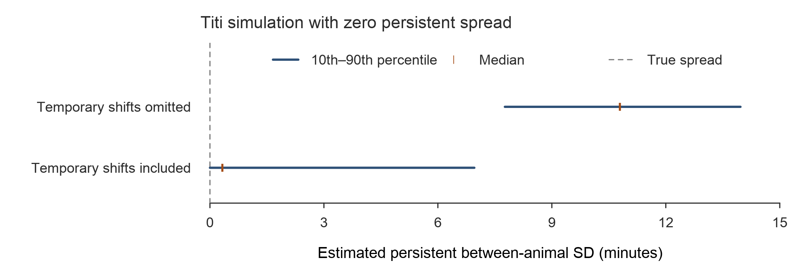
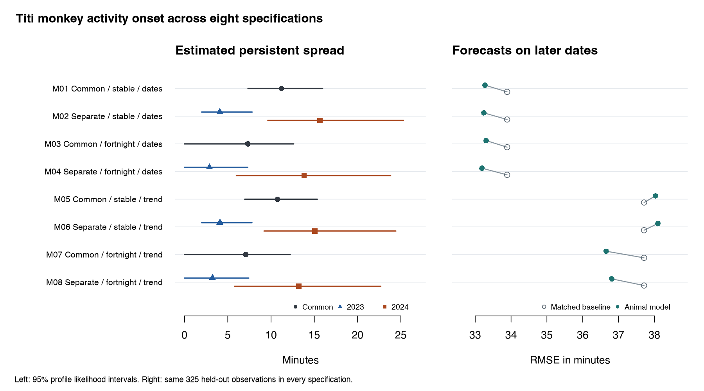
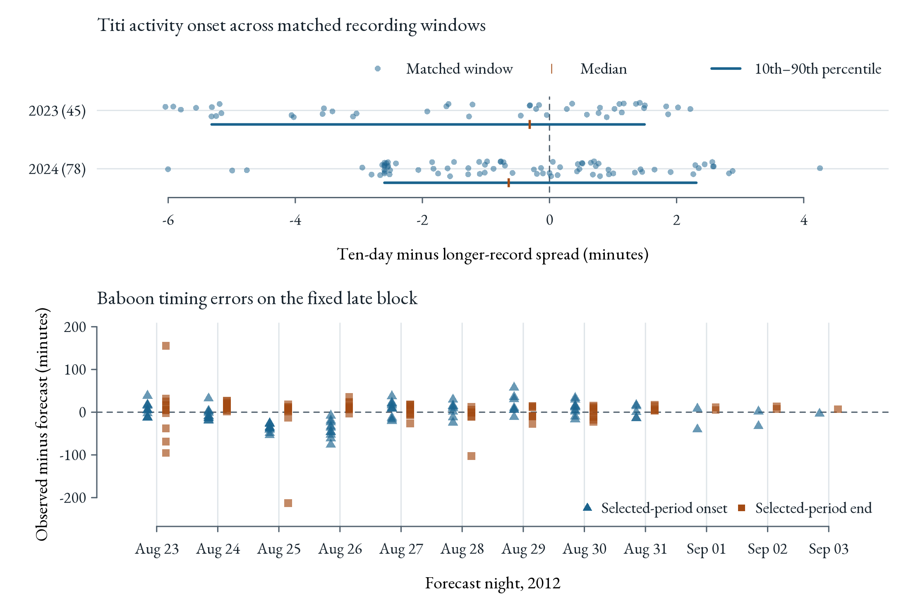

# Supporting model and forecast diagnostics
<!-- SUMMARY: Simulation recovery, recording blocks, forecasts, and conditional error checks for the primate timing paper · status: supporting material · updated: 2026-11-21 -->

## Titi simulation recovery

**Figure S1.** Estimated common persistent standard deviation (SD) in 100 simulations on the observed titi schedule. The true persistent spread is zero (dashed line), and the temporary and daily residual standard deviations are both 20 minutes. Rust-coloured ticks mark medians and blue lines span the 10th to 90th percentiles of the estimates. The illustration uses the smaller of the pilot’s two daily noise settings. [Simulation summaries](../analysis/results/titi-multiverse-simulations.csv)

## Titi absolute forecast errors

**Figure S2.** Root mean squared error (RMSE) on the same 325 titi observations for all eight specifications. Hollow squares show matched baselines and filled blue circles show animal models. Each line joins two forecasts evaluated on the same records. The point locations show absolute accuracy, and the distance and direction between them show the gain or loss from adding the animal terms. [Titi fixed scores](../analysis/results/titi-multiverse-forecasts.csv)

## Recording blocks

Fourteen-day calendar blocks start at the first recorded date and continue through gaps. The first titi blocks are 10–23 June 2023 and 14–27 February 2024. The baboon blocks are 1–14 August, 15–28 August, and 29 August–11 September 2012, with the last observation on 3 September.

| Sample | Occupied blocks per animal, with number of animals in parentheses |
|---|---|
| Titi 2023 | 5 (2), 6 (7) |
| Titi 2024 | 1 (5), 4 (2), 6 (2), 9 (1), 10 (1) |
| Baboon full record | 1 (10), 2 (2), 3 (10) |
| Baboon first 20 numbered nights | 1 (10), 2 (12) |

The baboon restriction includes 238 paired records through 19 August. For specifications with temporary effects, the animal-fortnight was present in training for 40 of 325 fixed titi forecasts, 59 of 85 fixed baboon forecasts, and 145 of 156 rolling baboon forecasts. New groups receive a zero offset.

## Historical forecast benchmarks

Each forecast uses the mean or median timing among training observations, calculated separately by titi cohort or baboon endpoint. The rolling forecast uses only earlier nights. The late rolling subset contains the same animal-nights as the fixed baboon evaluation. RMSE and mean absolute error (MAE) are in minutes. [Benchmark scores](../analysis/results/primate-forecast-benchmarks.csv)

| Outcome and evaluation | Records | Mean RMSE | Mean MAE | Median RMSE | Median MAE |
|---|---:|---:|---:|---:|---:|
| Titi activity onset, fixed | 325 | 33.28 | 23.22 | 33.26 | 23.31 |
| Baboon period onset, fixed | 85 | 25.74 | 21.09 | 25.78 | 21.12 |
| Baboon period onset, rolling | 156 | 31.56 | 22.40 | 31.41 | 22.29 |
| Baboon period onset, late rolling | 85 | 25.85 | 21.25 | 25.85 | 21.22 |
| Baboon period end, fixed | 85 | 36.07 | 18.52 | 36.43 | 16.88 |
| Baboon period end, rolling | 156 | 42.40 | 21.13 | 43.36 | 20.97 |
| Baboon period end, late rolling | 85 | 36.12 | 18.45 | 36.43 | 16.88 |

## Rolling forecast scores

The table compares the two scoring targets on the same 155 onset observations from 18 nights with multiple animals. Gains are baseline minus animal-model loss. The columns in minutes squared weight observations equally. Counts show how many nights had a positive mean gain and describe variation across nights. [Scores by night](../analysis/results/baboon-rolling-by-night.csv) · [All rolling summaries](../analysis/results/baboon-rolling-summary.csv)

The RMSE gain is the mean squared error (MSE) gain divided by the sum of the baseline and animal-model RMSEs. With the same MSE gain, the RMSE gain is larger when that sum is smaller.

| Trend | Fortnight | Clock MSE gain (min²) | Centred MSE gain (min²) | Nights improved, clock | Nights improved, centred |
|---|---|---:|---:|---:|---:|
| No | No | 11.0 | 52.8 | 9 | 10 |
| Yes | No | 8.5 | 52.8 | 9 | 10 |
| No | Yes | 34.0 | 26.4 | 12 | 8 |
| Yes | Yes | 15.1 | 27.9 | 12 | 8 |

The late portion of the rolling evaluation uses the same 85 records as the fixed block. The rolling fits also update their history and have a next-night forecasting horizon. The two evaluations describe distinct ways of using past observations. [Titi fixed scores](../analysis/results/titi-multiverse-forecasts.csv) · [Baboon fixed scores](../analysis/results/baboon-sleep-forecasts.csv)

## Recording windows and fixed-holdout errors

**Figure S3.** Matched titi recording windows (top) and errors on 85 later baboon-nights (bottom). Each blue circle gives the ten-day minus longer-record estimate for one titi window. Numbers in parentheses count windows, which can overlap and share observations. Rust-coloured ticks mark medians and blue lines span the 10th to 90th percentiles. Each baboon observation contributes a selected-period onset error (triangle) and end-time error (square).

## Bayesian sensitivity

The matched Bayesian comparison covers all 16 Gaussian specifications and preserves their original terms, training records, holdouts and historical benchmarks. Four Stan chains sample under a half-normal prior with a 30-minute scale on the persistent standard deviation. I reweight the draws by the prior density ratio for the 15-minute scale and average forecasts over the posterior.

| Outcome | Original fitted persistent SD (min) | Posterior medians across priors (min) |
|---|---:|---:|
| Baboon period onset | 10.6–10.7 | 10.3–11.2 |
| Baboon period end | 0–3.2 | 2.4–3.5 |
| Titi onset, 2023 cohort | 2.9–4.1 | 3.1–4.6 |
| Titi onset, 2024 cohort | 13.2–15.6 | 13.2–16.7 |

With the 30-minute prior, adding the persistent onset effect improved pooled rolling baboon RMSE by 0.12–0.54 minutes. On the same 85 observations as the fixed block, changes ranged from a 0.81-minute worsening to a 0.70-minute improvement. The 354 final fits had zero divergent transitions. Across monitored coefficients and scale parameters, the largest split R-hat was 1.010, and the smallest bulk and tail effective sample sizes were 299 and 115, respectively. The 15-minute prior weights retained at least 93.9% of the draws by the weight-based effective sample size calculation. The [comparison and reproduction guide](first-paper-bayesian-check.md) gives the full priors, forecast scores and per-fit diagnostics.

## Extreme errors and likelihood

Each check takes the maximum absolute error across 85 records from 12 nights. The 2,000 simulated maxima per row use the same schedule, with a normal draw shared by animals on each night and an independent residual per observation. Fitted parameters and animal offsets are held fixed. The check also holds temporary offsets fixed when those terms appear in a specification. The quantiles summarize these conditional simulations. The matched maximum likelihood (ML) fits use the same 269 training records.

| Endpoint and fit for the simplest specification | Observed (min) | Simulated median (min) | Central 95% (min) | 99th percentile (min) |
|---|---:|---:|---:|---:|
| Period onset, Gaussian restricted ML | 76 | 85 | 65–119 | 126 |
| Period end, Gaussian restricted ML | 213 | 81 | 63–113 | 120 |
| Period end, Gaussian ML | 213 | 81 | 62–112 | 119 |
| Period end, Student-t ML with 3 degrees of freedom | 220 | 60 | 34–176 | 239 |
| Period end, Student-t ML with 7 degrees of freedom | 219 | 49 | 34–90 | 108 |

The main Gaussian analysis uses restricted maximum likelihood. The fixed degrees of freedom examine two tail weights with finite variance. Several freely estimated degrees-of-freedom fits were unstable, and usable fits suggested values near 1.3. At each fixed positive animal standard deviation, I reoptimized the remaining free parameters. At zero, I refitted the specification without the animal term. In the simplest Student-t fits, the negative log likelihood rose by 0.18 and 0.04 at zero for 3 and 7 degrees of freedom, and by 2.73 and 1.85 at 4 minutes. [Gaussian checks](../analysis/results/baboon-gaussian-error-maxima.csv) · [Matched likelihood and optimizer details](../analysis/results/baboon-waking-likelihood.csv) · [Profile grid](../analysis/results/baboon-waking-likelihood-profile.csv)
