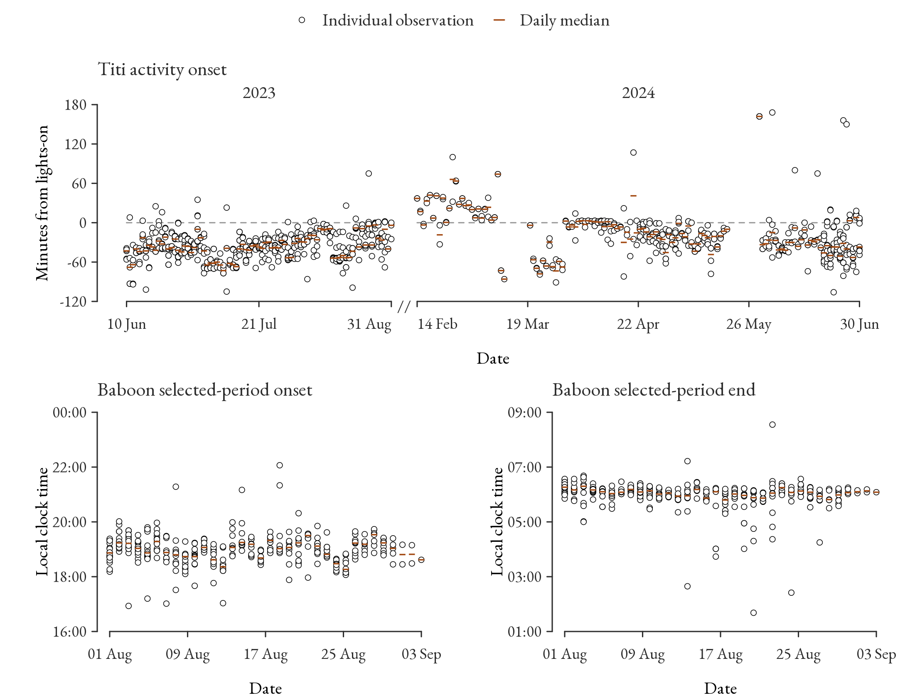
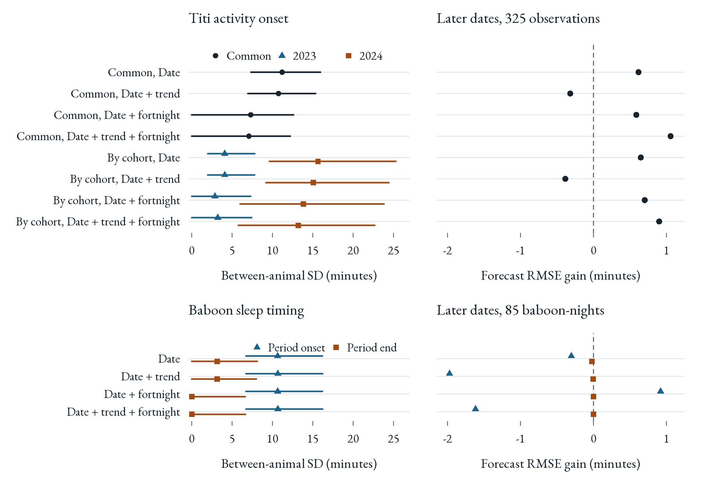

# Individual variation and forecast accuracy in titi monkey activity onset and olive baboon sleep timing

Brett Reynolds ([ORCID](https://orcid.org/0000-0003-0073-7195))\
Humber Polytechnic and University of Toronto\
[brett.reynolds@humber.ca](mailto:brett.reynolds@humber.ca)

## Abstract

How much does a persistent individual difference in daily timing help predict an animal’s timing on later dates? I use a multiverse of mixed models to reanalyse activity onset in two captive titi monkey cohorts and the onset and end of the selected sleep period in a wild olive baboon troop. Allowing temporary shifts reduced the estimated common persistent spread in titi onset from 11.2 to 7.3 minutes. When spreads could differ by cohort, estimates were 3–4 minutes in 2023 and 13–16 minutes in 2024. The simplest titi animal model and a historical cohort mean both gave a root mean squared forecast error of about 33.3 minutes on held-out dates. In baboons, estimated persistent spread was about 11 minutes for selected-period onset and 0–3 minutes for its end, with an upper interval limit of 8 minutes in the simplest end-time model. Adding a persistent animal effect lowered rolling clock-time error for the selected onset by 0.2–0.6 minutes, with gains and losses on a fixed holdout. These cases show how appreciable individual differences can coexist with little forecast improvement, and how that improvement depends on the benchmark and dates evaluated.

**Keywords**\
individual repeatability, forecast evaluation, activity onset, sleep timing, primates

**AI use.** The large language models OpenAI Codex, Gemini 4 Neon, Claude Opus 5.5, and Muse Wonder Full served as drafting and editing aids throughout the preparation of this paper. I am responsible for all theoretical claims, arguments, errors, and interpretive choices.

## Introduction

An animal may consistently fall asleep later than its group-mates, even when its bedtime is hard to predict. Its timing can shift with the group or vary from night to night. I estimate the spread of the timing offsets that persist across an animal’s recorded nights. I then ask how much using an animal’s earlier observations reduces forecast error on later dates. Regular conditions, such as an animal’s habitual sleeping location, can also produce a persistent offset.

Refinetti et al. compared within- and between-individual variation in activity timing across mammals under controlled conditions. Loftus et al. reported that the selected sleep period ended at more consistent times across animals and dates than it began in a wild baboon troop. [Refinetti et al., 2016](https://doi.org/10.1016/j.physbeh.2016.04.019) · [Loftus et al., 2022, Figure 1](https://doi.org/10.7554/eLife.73695)

I use the two archives as methodological case studies. The paired baboon records let me compare estimated individual spread and forecast performance for two endpoints on the same animal-nights. The titi records show how estimates and forecasts respond to decisions about cohort pooling, temporary individual shifts, and calendar trends.

## Methods

### Records and timing measures

The titi archive contains 1,007 usable records from 20 captive animals. The 2023 cohort contributed 572 records from nine animals between 10 June and 31 August. The 2024 cohort contributed 435 from 11 animals between 14 February and 30 June. Individual records have gaps in both cohorts, and the 2024 cohort also has dates with no observations. The source study estimated daily activity onset as the rest-to-activity step that best matched a binarized locomotor activity signal. I express onset in minutes relative to scheduled lights-on at 06:00. [Rodríguez Ferrante et al., 2026](https://doi.org/10.64898/2026.01.27.701907) · [Archived onset table](https://github.com/guadarf/Lunar-gravity-sleep/blob/a499224e6972c277cfd889e614e39e94e85d8276/data/Data_S3_all_onsetData_titi.csv)

For the baboons, I reconstructed sleep endpoints using the published accelerometer classification. The procedure identifies low-activity blocks and merges blocks separated by short gaps. I use *selected sleep-period onset* and *selected sleep-period end* for the boundaries of the longest resulting period. The source study calls these boundaries sleep onset and waking. I measure both in minutes since the start of the local noon-to-noon interval. The published coverage rules yielded 354 paired records from 22 olive baboons on 34 night dates from 1 August to 3 September 2012. Animals contributed one to 30 nights, with a median of 21. [Loftus et al., 2022](https://doi.org/10.7554/eLife.73695) · [Movebank archive](https://doi.org/10.5441/001/1.3q2131q5) · [Reconstructed records](../analysis/results/baboon-sleep-pairs.csv)

**Figure 1.** Observed timing by date. The upper panel shows 572 titi onsets in 2023 and 435 in 2024 relative to scheduled lights-on (grey dashed line). The date axis breaks between cohorts and uses the same scale on either side. The two baboon panels show the same 354 animal-nights and each spans eight hours. Both boundaries are plotted against the date the night began. White circles with black outlines show individual observations. Thin rust-coloured dashes mark daily medians.

### Models of individual timing

Each Gaussian mixed model includes an animal intercept for the offset shared by all observations of that animal and a date intercept for changes shared by animals on a date. Titi models fit distinct cohort means and date effects within cohort. Adding an animal-by-fortnight intercept lets the same animal shift independently in each 14-day calendar block. The model treats offsets across blocks as independent conditional on the persistent intercept and treats animal, date, block and residual effects as independent. These assumptions define persistence over the observed period. [Model specifications and block coverage](forecast-diagnostics.md#recording-blocks)

Blocks start on the first observed date for each titi cohort and for the baboon troop. The 2023 titi animals occupied five or six blocks each. The 2024 animals occupied one to ten. Of the 22 baboons, ten occupied one block, two occupied two blocks, and ten occupied all three.

I repeated the baboon estimates on the source study’s first 20 numbered nights to restrict the comparison to the period before the inferred leopard encounter and move to a less familiar sleeping site. Each animal occupied at most two blocks in that period. [Loftus et al., 2022, Figure 3](https://doi.org/10.7554/eLife.73695)

For this exploratory multiverse, I crossed the choices in Table 1 after a titi pilot that compared common and separate animal spreads and tested recovery under simulated timing. I fitted the Gaussian specifications by restricted maximum likelihood and report the standard deviation (SD) of animal intercepts with 95% profile likelihood intervals. [Steegen et al., 2016](https://doi.org/10.1177/1745691616658637)

**Table 1.** Choices crossed in the model multiverse.

| Model choice | Titi activity onset | Baboon selected-period boundaries |
|---|---|---|
| Persistent animal spread | Common across cohorts or separate | One spread per endpoint |
| Temporary animal offsets | Without or with a fortnight term | Without or with a fortnight term |
| Linear calendar trend | Without or with a trend by cohort | Without or with a trend for the troop |
| Specifications | Eight | Four per endpoint |

### Forecasting later observations

The fixed evaluation held out the final third of observed dates. Test dates were 4–31 August 2023 and 12 May–30 June 2024 for the titi cohorts, and 23 August–3 September 2012 for the baboons. I scored 325 titi observations and 85 paired baboon-nights from animals with training records.

The rolling baboon evaluation starts after the first 15 observed dates, with a refit before each later night. It scores 156 paired records on 19 nights from 16 August to 3 September. The fixed evaluation represents forecasts made from a single training period. The rolling evaluation uses the history available for each next night.

To measure what the animal terms add, I refitted a matched baseline on the same training data as each animal model. The titi baseline retains cohort and date effects and the specified trend. It omits both persistent and temporary animal effects. The baboon baseline retains the temporary effect when specified and omits only the persistent intercept. Forecasts use the estimated offset for a known animal-fortnight and a zero offset for a new one. Future date offsets also contribute zero.

To see how well a simple clock-time forecast would do, I also used the mean and median of the training observations in each titi cohort or for each baboon endpoint. I scored these historical benchmarks on the same observations using the same forecast dates and training histories as the model comparisons. [Historical benchmarks](forecast-diagnostics.md#historical-forecast-benchmarks)

I report root mean squared error (RMSE) and mean absolute error (MAE) in minutes. For the baboons I also subtract each night’s mean error before scoring, omitting nights with only one observed animal from that comparison. This evaluates timing differences among the animals observed that night. I use the night’s observations only when scoring the forecasts. I compare changes in mean squared error (MSE) on the same records to examine whether differences in RMSE gains persist before taking square roots.

### Sensitivity checks

I refitted all 16 Gaussian specifications and their matched baselines using Bayesian estimation. I compared half-normal priors with scales of 15 and 30 minutes for the persistent standard deviation. I scored posterior-mean forecasts on the same holdouts and used the same historical benchmarks. [Bayesian sensitivity details](forecast-diagnostics.md#bayesian-sensitivity)

I replayed the titi recording schedule with simulated activity onsets. The temporary-shift illustration sets the true persistent spread to zero and gives temporary offsets and daily residuals the same 20-minute standard deviation.

I used ten-day windows following Refinetti et al.’s use of ten consecutive days of records. My windows can contain missing days. I compare each window with a longer history of the same animals ending on the same date. Refinetti et al.’s chronotype spread spans roughly four standard deviations, and my estimate is a standard deviation. [Refinetti et al., 2016](https://doi.org/10.1016/j.physbeh.2016.04.019)

I simulated 2,000 sets of forecast errors on the fixed baboon holdout schedule for each endpoint in the simplest model. For selected-period end, I also compared Gaussian and Student-t residuals at fixed 3 and 7 degrees of freedom using matched maximum-likelihood fits. I simulated a shared offset for each night and an independent residual for each record, holding fitted parameters and the other fitted offsets fixed. I compare the largest absolute observed error with quantiles of the simulated maxima. [Gelman et al., 2020, §§6.1–6.2](https://arxiv.org/html/2011.01808#S6) · [Simulation and likelihood details](forecast-diagnostics.md#extreme-errors-and-likelihood)

## Results

### Titi activity onset

Cohort-specific estimates of persistent spread ranged from 2.9 to 4.1 minutes in 2023 and from 13.2 to 15.6 minutes in 2024. These cohorts differ in animals, years, and recording periods. Holding the trend and temporary-offset terms fixed, fitting cohort-specific spreads changed pooled holdout RMSE by at most 0.16 minutes. The cohort choice mattered more for the fitted spreads than for accuracy on these holdouts. [Paired specification contrasts](../analysis/results/titi-multiverse-contrasts.csv)

In the model with shared spread and no calendar trend, allowing temporary offsets reduced the estimate from 11.2 to 7.3 minutes. The intervals were 7.3–16.0 and 0–12.6 minutes.

On the original schedule with simulated temporary offsets and zero persistent spread, a model omitting the offsets estimated a median persistent spread of 10.8 minutes. Including the offset term gave a median of 0.3 minutes, with the central 80% of estimates ranging from 0 to 7.0 minutes. This illustrates how a temporary difference can enter the estimated persistent component. In the actual records, shortening the windows moved the estimated spread in both directions, with median changes of −0.3 and −0.6 minutes. [Simulation quantiles, Figure S1](forecast-diagnostics.md#titi-simulation-recovery) · [Recording-window comparisons, Figure S3](forecast-diagnostics.md#recording-windows-and-fixed-holdout-errors)

The simplest titi animal model reduced RMSE from 33.89 to 33.27 minutes against its matched baseline (Table 2). The historical cohort mean gave 33.28 minutes. Pooled RMSE was 36.65–38.10 minutes with a calendar trend and 33.19–33.30 minutes without one. Both the largest gain over a matched baseline (1.06 minutes) and the largest worsening (0.39 minutes) came from specifications with a trend. [Absolute forecast errors, Figure S2](forecast-diagnostics.md#titi-absolute-forecast-errors)

The pooled comparison masks different results by cohort. Holding the other modelling choices fixed, adding a trend reduced RMSE by 1.5–1.9 minutes in 2023 and increased it by 7.3–9.6 minutes in 2024. [Paired specification contrasts](../analysis/results/titi-multiverse-contrasts.csv)

### Baboon selected-period onset and end

Across the four specifications, the estimated persistent spread was 10.6–10.7 minutes for the selected-period onset and 0–3.2 minutes for its end. In the simplest model, the endpoint-specific intervals were 6.7–16.2 and 0–8.1 minutes. The end-time estimates were zero with temporary offsets and their upper limits were about 7 minutes. Fitting only the first 20 numbered nights preserved the ordering of the estimates. The intervals describe the two spreads separately, so the comparison here is the ordering of the fitted values across models. [Paired estimates](../analysis/results/baboon-sleep-estimates.csv)

**Figure 2.** Estimated persistent between-animal standard deviation (SD) with 95% profile likelihood intervals (left) and fixed-holdout RMSE gain relative to each specification’s baseline (right). Positive gain means lower error with the animal model. For titi onset the independently fitted baseline omits persistent and temporary animal terms. For baboon timing the baseline omits only the persistent intercept.

**Table 2.** Forecast errors in minutes for the simplest Gaussian specification. Arrows run from the baseline to the animal model. Gains are baseline minus animal-model RMSE before rounding. The two evaluation schedules sample different nights and training histories.

| Outcome and evaluation | Records | RMSE | RMSE gain | MAE |
|---|---:|---:|---:|---:|
| Titi activity onset, fixed | 325 | 33.89 → 33.27 | 0.62 | 24.30 → 22.83 |
| Baboon period onset, fixed | 85 | 25.81 → 26.12 | −0.30 | 21.14 → 20.80 |
| Baboon period end, fixed | 85 | 36.12 → 36.14 | −0.02 | 18.98 → 19.00 |
| Baboon period onset, rolling | 156 | 31.59 → 31.36 | 0.23 | 22.42 → 22.12 |
| Baboon period end, rolling | 156 | 42.26 → 42.43 | −0.17 | 21.23 → 21.34 |

On the fixed block, adding the persistent term changed onset RMSE by between a 0.9-minute improvement and a 2.0-minute worsening. On all 156 rolling observations RMSE fell by 0.2–0.6 minutes across specifications. Scoring the rolling forecasts on the same 85 records as the fixed evaluation yielded changes from a 0.79-minute worsening to a 0.79-minute improvement. [Rolling summaries](../analysis/results/baboon-rolling-summary.csv)

End-time RMSE changed by less than 0.2 minutes in either evaluation. On the fixed block, the historical troop median gave an end-time MAE of 16.88 minutes, compared with 19.00 for the simplest animal model. In the simplest rolling onset model, clock-time squared error fell on nine of the 18 nights with multiple animals and night-centred squared error fell on ten. [Historical benchmarks](forecast-diagnostics.md#historical-forecast-benchmarks) · [Nightly scores](../analysis/results/baboon-rolling-by-night.csv)

In the same model, night-centred RMSE fell from 25.1 to 24.0 minutes. On the same 155 observations, centring increased the MSE gain in three of four specifications. [Matched comparisons](forecast-diagnostics.md#rolling-forecast-scores)

### Bayesian refits

The Bayesian refits preserved the ordering of the baboon estimates. Across both priors, posterior medians were 10.3–11.2 minutes for selected-period onset and 2.4–3.5 minutes for its end. The continuous prior puts all its mass on positive spreads. For the two end-time specifications whose original estimates were zero, the 95% credible intervals extended from near zero to about 8 minutes. Adding the persistent animal effect slightly increased pooled rolling end-time RMSE in all four specifications.

For the titi monkeys, the simplest Bayesian model and the historical cohort mean both gave a held-out RMSE of about 33.3 minutes. Calendar trends again helped forecasts for 2023 and worsened forecasts for 2024. [Matched Bayesian results](first-paper-bayesian-check.md#results)

### Extreme end-time forecast errors

Two dates accounted for 79% of the squared end-time forecast error in the simplest Gaussian model (Figure S3). One animal accounted for 98% of its night’s loss on 25 August and another for 58% on 23 August. Those records correspond to selected periods ending at 02:25 and 08:33. Both passed the published accelerometer coverage rules. [Error concentration by night](../analysis/results/baboon-fixed-waking-error-concentration.csv) · [Fixed-holdout forecast errors](forecast-diagnostics.md#recording-windows-and-fixed-holdout-errors)

In the simplest Gaussian fit, the largest observed absolute error was 76 minutes for onset, within the central 95% of simulated maxima (65–119 minutes). For period end the observed maximum was 213 minutes, versus a central interval of 63–113 minutes. In the simplest matched Student-t fit with 3 degrees of freedom, the observed maximum was 220 minutes and simulated maxima had a median of 60 minutes and a 99th percentile of 239 minutes. Student-t fits lowered end-time MAE on the fixed block and still estimated a persistent spread no larger than 1.3 minutes. [Tail comparisons and model diagnostics](forecast-diagnostics.md#extreme-errors-and-likelihood)

## Discussion

An animal’s persistent offset accounts for one part of observed timing. Changes shared across a night and variation within an animal also contribute to forecast error. Across specifications, the baboon models estimated a persistent spread of about 11 minutes for selected-period onset. The clock-time gains from using animal history were small and depended on the dates scored. The smaller end-time estimates came with still smaller changes in forecast accuracy.

A gain against a matched baseline can coexist with little practical advantage over a historical benchmark. The simplest titi animal model improved on its matched baseline and gave nearly the same RMSE as forecasting the historical cohort mean. On the fixed block for baboon period end, forecasting the historical troop median gave lower MAE than the simplest animal model.

In the titi archive, the cohort-specific estimates and the response to temporary offsets show two ways a common spread can obscure variation in these records. The simulation isolates one mechanism by which short-lived differences can enter the animal intercept. In the observations, estimates changed in both directions across ten-day windows. Recording duration and the model of temporary change affect what the estimate can describe.

The two extreme Mpala end times had acceleration coverage at the classified boundary. In the companion paper, *How the choice of sleep endpoint changes estimates of individual variation in primates*, I found later classified low-activity periods after 21 of 22 pre-midnight ends in a separate Laikipia archive. That gives a mechanism to check in the Mpala traces. Whether it accounts for either Mpala record remains unresolved. The residual model also changed the expected size of extreme errors in these forecasts. [Companion analysis](comparative-waking-feasibility.md#early-classified-waking-times)

An individual effect can include regularly experienced conditions, such as sleeping location or social arrangements. Loftus et al. observed more synchronized overnight waking among nearby troopmates, and Hozer et al. found differences in chimpanzee nesting and waking across social contexts. Comparing behavioural timing across species requires comparable measurements and defensible sampling. Attributing such differences to endogenous clocks requires evidence that distinguishes clock differences from shared conditions and recurrent individual circumstances. [Loftus et al., 2022](https://doi.org/10.7554/eLife.73695) · [Hozer et al., 2026](https://doi.org/10.1016/j.cub.2025.11.057)

For studies of individual timing, show how observations are distributed across animals and recording periods, and how allowing temporary shifts changes estimates of persistent spread. When the aim includes forecasting, score the animal model, its matched baseline, and a training-only mean or median on the same held-out records. If a few classified endpoints dominate the forecast error, inspect the activity traces and the bout boundaries that determine those endpoints before interpreting the errors biologically.

## Data and code

The project repository documents the source versions, reconstruction steps, model specifications, and commands for regenerating the tables and figures. The supporting diagnostics give complete forecast scores and conditional simulation summaries. [Project repository](https://github.com/BrettRey/primate-chronotypes) · [Data and reproduction guide](../README.md) · [Supporting diagnostics](forecast-diagnostics.md)

## References

- Gelman, A., et al. (2020). Bayesian workflow. *arXiv*. [Preprint](https://arxiv.org/abs/2011.01808)
- Hozer, C., et al. (2026). Rank and social context influence sleep in wild chimpanzees. *Current Biology*, 36, 199–208.e4. [Article](https://doi.org/10.1016/j.cub.2025.11.057)
- Loftus, J. C., Harel, R., Nuñez, C. L., & Crofoot, M. C. (2022). Ecological and social pressures interfere with homeostatic sleep regulation in the wild. *eLife*, 11, e73695. [Article](https://doi.org/10.7554/eLife.73695)
- Refinetti, R., et al. (2016). Variability of behavioral chronotypes of 16 mammalian species under controlled conditions. *Physiology & Behavior*. [Article](https://doi.org/10.1016/j.physbeh.2016.04.019)
- Rodríguez Ferrante, G., et al. (2026). Lunar gravity predicts sleep timing. *bioRxiv*. [Preprint](https://doi.org/10.64898/2026.01.27.701907)
- Steegen, S., Tuerlinckx, F., Gelman, A., & Vanpaemel, W. (2016). Increasing transparency through a multiverse analysis. *Perspectives on Psychological Science*, 11, 702–712. [Article](https://doi.org/10.1177/1745691616658637)
