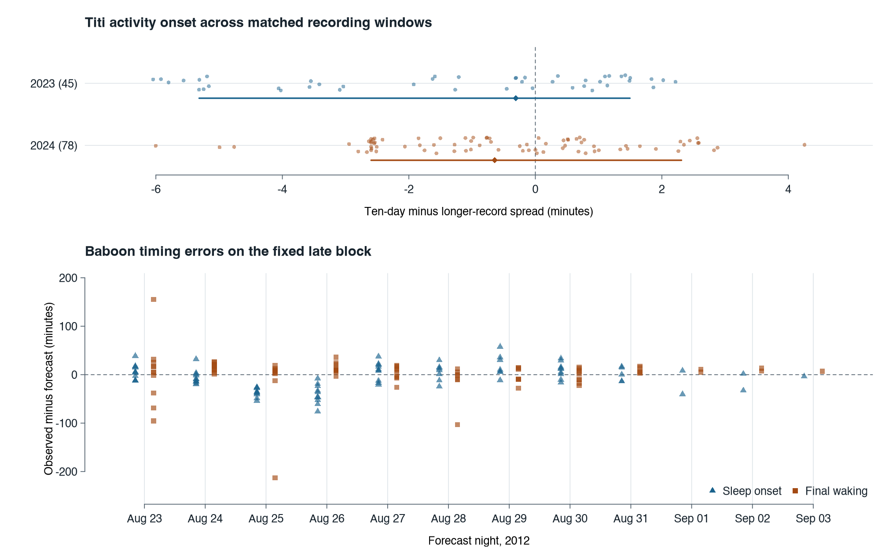

# A multiverse analysis of daily timing in titi monkeys and olive baboons

## Abstract

Animals in the same group can differ in when they become active, fall asleep, or wake. How much of that variation persists across days, and how much does it help predict timing? I reanalysed activity onset in captive titi monkeys and sleep onset and final waking in wild olive baboons, crossing choices about temporary animal effects, calendar trends, and cohort pooling where applicable. In the titi monkeys, allowing temporary shifts reduced the estimated common between-animal standard deviation from 11.2 to 7.3 minutes. In the baboons, estimates across models were 10.6–10.7 minutes for sleep onset and 0–3.2 minutes for final waking on the same animal-nights. Including persistent animal effects in night-by-night forecasts reduced root mean squared error for baboon onset by 0.18–0.57 minutes for clock time and by 0.53–1.08 minutes relative to other baboons. Waking forecast errors changed by less than 0.20 minutes. The usefulness of an animal’s timing history depends on the outcome and the dates being predicted.
## Introduction

A distribution of daily timing can combine several sources of variation. Animals may differ consistently, an animal may shift for several days, and the whole group may shift together. A short record can make a temporary shift look like a lasting individual difference. The timing measure also matters. The start of locomotor activity and the end of a sleep period can respond to different cues. Comparative work has used activity onset to describe differences in timing under controlled conditions, and field studies link sleep timing and synchrony to social surroundings. [Refinetti et al., 2016](https://doi.org/10.1016/j.physbeh.2016.04.019) · [Loftus et al., 2022](https://doi.org/10.7554/eLife.73695) · [Hozer et al., 2026](https://doi.org/10.1016/j.cub.2025.11.057)

I estimate persistent differences within each recording setting and ask whether those differences help predict later observations of the same animals. The titi case examines how the model assigns variation to persistent differences and temporary shifts. The baboon case compares two endpoints measured in the same animals on the same nights.
## Methods

### Records and timing measures

The titi archive contains 1,007 usable activity-onset observations from 20 captive animals. The 2023 cohort contributed 572 records from nine animals and the 2024 cohort contributed 435 from 11. The source study used a fixed light schedule with lights on at 06:00. I express activity onset in minutes relative to that schedule. [Rodríguez Ferrante et al., 2026](https://doi.org/10.64898/2026.01.27.701907) · [Archived onset table](https://github.com/guadarf/Lunar-gravity-sleep/blob/a499224e6972c277cfd889e614e39e94e85d8276/data/Data_S3_all_onsetData_titi.csv)

For the baboons, I reconstructed the sleep-period endpoints from accelerometry using the source study’s classification and coverage rules. Both endpoints are measured in minutes from the start of the local noon-to-noon interval. The reconstruction yielded the published count of 354 sleep periods, representing 22 olive baboons and 34 local night dates. Records per animal ranged from one to 30, with a median of 21. Each retained record contributes both endpoints. [Loftus et al., 2022](https://doi.org/10.7554/eLife.73695) · [Movebank archive](https://doi.org/10.5441/001/1.3q2131q5) · [Reconstructed timing table](../analysis/results/baboon-sleep-pairs.csv)

### Model multiverse

I fitted Gaussian mixed models by restricted maximum likelihood. Each model has a random effect shared by animals on each date and an animal random intercept for differences that persist over the recording period. I report the latter’s standard deviation in minutes with a 95% profile likelihood interval. The titi models include a mean for each cohort and a shared random effect for each cohort-date.

I crossed the choices in Table 1 and show every specification of the Gaussian model multiverse in Figure 1. Each specification within an endpoint uses the same records. The choices were made after the pilot. [Steegen et al., 2016](https://doi.org/10.1177/1745691616658637)

**Table 1.** Choices crossed in the model multiverse.

| Model choice | Titi activity onset | Baboon sleep onset and final waking |
|---|---|---|
| Persistent between-animal spread | Common across cohorts or cohort-specific | One spread per endpoint in one troop |
| Temporary animal effects | Absent or one effect per animal per 14-day block | Same two options |
| Linear calendar trend | Absent or cohort-specific | Absent or one trend for the troop |
| Specifications | Eight | Four per endpoint |

I fit each baboon endpoint separately on the same pairs. I also repeat the estimates on the first 20 nights as numbered in the source study. That restriction follows the period used for its main models before the inferred leopard encounter and the move to a less familiar sleeping site. [Loftus et al., Figure 3 and Methods](https://doi.org/10.7554/eLife.73695)

### Forecasts and sensitivity checks

For the fixed forecasts, I train on roughly the first two-thirds of recording dates, within cohort for the titi monkeys. I score the final dates for animals observed in training. This gives 325 titi observations and 85 baboon-nights. Shared date effects for future dates contribute zero to the forecast. Titi baselines include cohort and shared date effects, with the corresponding trend when fitted. The baboon baseline for each specification also retains its temporary animal effect when applicable, so its comparison isolates adding the persistent term.

I replay the titi recording schedule with simulated timing and compare observed ten-day windows with longer histories ending on the same day. For the baboons, I update the models before each forecast night using all available earlier records. In addition to clock-time error, I score relative timing by centring forecast errors within each night with at least two animals. [Analysis instructions](../README.md)

I also check the size of extreme baboon forecast errors in the simplest Gaussian animal model. I simulate 2,000 repetitions of the fixed holdout schedule, drawing a shared offset for each night and an individual residual for each record from the fitted Gaussian distributions. This check holds the fitted parameters and animal predictions fixed. I compare the observed maximum absolute error with the median of the simulated maxima. [Gelman et al., 2020, §§6.1–6.2](https://arxiv.org/html/2011.01808#S6)

For final waking, I also compare Gaussian and Student-t residuals using maximum likelihood for both families. Fits with freely estimated degrees of freedom were numerically unstable in several specifications. I use fixed values of 3 and 7 to compare two heavier-tailed distributions with finite variance. For each waking specification, I retain the same records, random effects, and forecast dates. I examine the approximate likelihood at fixed animal spreads from 0 to 8 minutes in the simplest specification. [Fitting software](https://glmmtmb.github.io/glmmTMB/reference/nbinom2.html)

## Results

### Titi activity onset

In the common-spread model with shared date effects and no trend, the estimated persistent spread fell from 11.2 to 7.3 minutes when the model allowed temporary shifts. The intervals were 7.3–16.0 and 0–12.6 minutes. In models with separate cohort spreads, the 2023 estimates ranged from 2.9 to 4.1 minutes and the 2024 estimates from 13.2 to 15.6. Across the eight specifications, including animal effects changed forecast RMSE on the same later observations by between a 1.06-minute improvement and a 0.39-minute worsening. [Estimates](../analysis/results/titi-multiverse-estimates.csv) · [Forecasts](../analysis/results/titi-multiverse-forecasts.csv)

In simulations on the original schedule with zero persistent spread and 20-minute standard deviations for both temporary offsets and daily residuals, the common-spread model without the temporary term estimated a median persistent spread of 10.8 minutes. Including the temporary term reduced that median to 0.3 minutes. The observed ten-day windows produced changes in both directions, with median short-minus-long changes of −0.3 minutes in 2023 and −0.6 in 2024. The windows overlap, and a ten-day calendar interval can contain substantially fewer observed days. [Simulation results](../analysis/results/titi-multiverse-simulations.csv) · [Window results](../analysis/results/titi-ten-day-summary.csv)
### Baboon sleep onset and waking

Across models fitted to all 354 baboon-nights, estimated persistent spread was 10.6–10.7 minutes for sleep onset and 0–3.2 minutes for final waking. For the simplest model, the intervals were 6.7–16.2 and 0–8.1 minutes, respectively. The waking point estimates were zero with a fortnight term, with interval upper bounds of 6.6–6.7 minutes in the full record. Fitting the first 20 numbered nights preserved the ordering of the point estimates. Each uncertainty interval describes one endpoint’s spread. [Paired estimates](../analysis/results/baboon-sleep-estimates.csv)

On the fixed late block, adding persistent animal effects changed onset forecast RMSE by between a 0.9-minute improvement and a 2.0-minute worsening. The absolute change in waking RMSE was below 0.03 minutes. In the simplest waking model, two dates accounted for 79% of the squared forecast error. Updating before each of 19 nights yielded 156 forecast pairs. Across models, persistent effects lowered onset RMSE by 0.18–0.57 minutes for clock time and 0.53–1.08 minutes for timing relative to the other animals on the night. Waking RMSE changed by less than 0.20 minutes. [Fixed-block forecasts](../analysis/results/baboon-sleep-forecasts.csv) · [Night-by-night forecasts](../analysis/results/baboon-rolling-summary.csv)

**Figure 1.** The model multiverse. Each row represents one combination of choices in Table 1. The left panels show estimated persistent between-animal standard deviations and 95% profile likelihood intervals. “Common” uses a shared standard deviation for the two titi cohorts. “By cohort” fits one per cohort. The right panels show baseline forecast RMSE minus animal-model forecast RMSE on the common late holdout. Positive gains indicate lower error with animal effects.

### Recording windows and extreme forecast errors

Figure 2 shows how the effect of shortening the titi record varies across windows and where the extreme baboon forecast errors occurred. The largest absolute waking error was 213 minutes. Its simulated median under the fitted Gaussian model was 81 minutes. For onset, the corresponding values were 76 and 85 minutes.

**Figure 2.** In the upper panel, dots show the estimated spread from the ten-day window minus that from a longer history ending on the same date for the same animals. Diamonds mark medians and lines span the 10th to 90th percentiles. In the lower panel, points show observed minus predicted timing for each baboon-night under the simplest animal model. Triangles mark sleep onset and squares mark final waking.

### Sensitivity to the waking likelihood

The largest waking forecast errors were associated with classified waking times of 02:25 and 08:33 local time. Both endpoints had an accelerometer record at the reported minute and met the source study’s coverage rules. I retained both observations.

The Student-t fits estimated persistent waking spreads from near zero to 1.3 minutes, compared with near zero to 2.9 minutes for the matched Gaussian fits. In the simplest Student-t model with 3 degrees of freedom, setting the spread to zero increased the negative log likelihood by 0.18, and setting it to 4 minutes increased it by 2.73. With 7 degrees of freedom the increases were 0.04 and 1.85. These profiles are shallow near zero. Some forecast fits with 7 degrees of freedom had nearly flat curvature at small variance components. [Estimates and diagnostics](../analysis/results/baboon-waking-likelihood.csv) · [Likelihood grid](../analysis/results/baboon-waking-likelihood-profile.csv)

On the same 85 held-out records, Student-t residuals lowered mean absolute error by 1.46–15.08 minutes across the matched comparisons. Changes in RMSE ranged from an 8.65-minute improvement to a 0.41-minute worsening. Within each Student-t specification, the RMSE gain attributable to persistent animal effects ranged from −0.33 to approximately 0 minutes. The fitted residual scales yielded median simulated maximum errors of 48–60 minutes, compared with observed maxima of 207–220 minutes. [Forecast comparisons](../analysis/results/baboon-waking-likelihood.csv)

## Discussion

The titi simulations show how temporary offsets can contribute to a fitted animal spread, and the ten-day comparisons show how the spread varies across recording windows. For the baboons, the paired design places the larger estimated spread at sleep onset. Individual histories contributed most to onset forecasts when the outcome was timing relative to other animals that night.

The heavier-tailed waking models improved typical clock-time predictions. Adding each animal’s persistent effect contributed little to these forecasts, and the largest observed errors remained well beyond typical simulated maxima. The check is conditional on one forecast block and the fitted parameter values. The extreme classified endpoints have adequate accelerometer coverage. Direct observation would be needed to distinguish unusual sleep from classification error in those cases. [Gelman et al., 2020](https://arxiv.org/html/2011.01808#S6)

Social structure and schedules can influence both the timing on a given night and the conditions an individual repeatedly experiences. For example, the baboon source study found more synchronized overnight waking among nearby group-mates. A shared date effect absorbs changes common to observed animals that day. Stable differences in housing, sleeping location, or social conditions can still contribute to an animal effect. [Loftus et al., 2022](https://doi.org/10.7554/eLife.73695) · [Literature and measurement notes](./literature-caveats.md)

The inferences concern two captive cohorts and one wild troop over their observed recording periods. A comparison of chronotype distributions across species would require comparable outcomes and a design that distinguishes endogenous timing from recurring social and environmental influences. Repeated timing measures and forecasts on comparable later records would make clear which differences carry across settings.
## Data and code

The repository documents source versions, reconstruction steps, model specifications, and commands for regenerating the result tables. Run `Rscript analysis/plot-primate-timing-summary.R` and `Rscript analysis/plot-primate-timing-diagnostics.R` from the repository root to regenerate the figures and the Gaussian error check. [Data and reproduction guide](../README.md)
## References

- Gelman, A., et al. (2020). Bayesian workflow. *arXiv*. [Preprint](https://arxiv.org/abs/2011.01808)
- Hozer, C., et al. (2026). Rank and social context influence sleep in wild chimpanzees. _Current Biology_, 36, 199–208.e4. [Article](https://doi.org/10.1016/j.cub.2025.11.057)

- Loftus, J. C., Harel, R., Nuñez, C. L., & Crofoot, M. C. (2022). Ecological and social pressures interfere with homeostatic sleep regulation in the wild. _eLife_, 11, e73695. [Article](https://doi.org/10.7554/eLife.73695)

- Refinetti, R., et al. (2016). Variability of behavioral chronotypes of 16 mammalian species under controlled conditions. _Physiology & Behavior_. [Article](https://doi.org/10.1016/j.physbeh.2016.04.019)

- Rodríguez Ferrante, G., et al. (2026). Lunar gravity predicts sleep timing. _bioRxiv_. [Preprint](https://doi.org/10.64898/2026.01.27.701907)
- Steegen, S., Tuerlinckx, F., Gelman, A., & Vanpaemel, W. (2016). Increasing transparency through a multiverse analysis. *Perspectives on Psychological Science*, 11, 702–712. [Article](https://doi.org/10.1177/1745691616658637)
